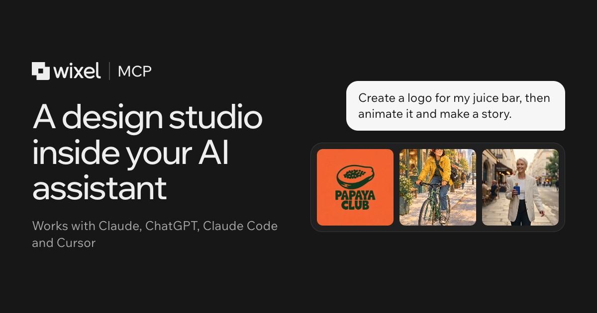
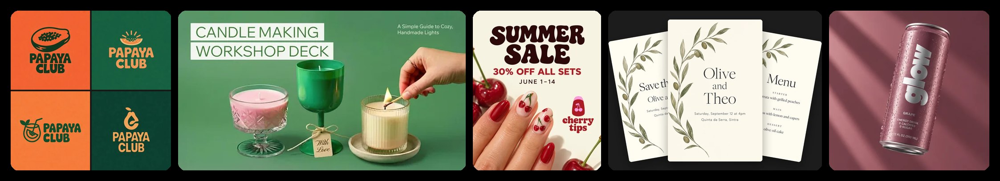

<div align="center">

<a href="https://www.wix.com/wixel/explore/mcp"></a>

<br><br>

  <a href="https://claude.ai/customize/connectors?modal=add-custom-connector&connectorName=Wixel&connectorUrl=https%3A%2F%2Fmcp.wix.com%2Fwixel%3Fref%3Dgithub"><picture><source media="(prefers-color-scheme: dark)" srcset="https://img.shields.io/badge/Add_to_Claude-ffffff?style=for-the-badge"></picture></a>
  <a href="https://chatgpt.com/plugins/plugin_asdk_app_6a12aae311d8819191625c2e688b153f"><picture><source media="(prefers-color-scheme: dark)" srcset="https://img.shields.io/badge/Add_to_ChatGPT-ffffff?style=for-the-badge"></picture></a>
  <a href="https://cursor.com/en-US/install-mcp?name=wixel&config=eyJ1cmwiOiJodHRwczovL21jcC53aXguY29tL3dpeGVsP3JlZj1jdXJzb3IifQ%3D%3D"><picture><source media="(prefers-color-scheme: dark)" srcset="https://img.shields.io/badge/Add_to_Cursor-ffffff?style=for-the-badge"></picture></a>
  <a href="https://insiders.vscode.dev/redirect/mcp/install?name=wixel&config=%7B%22type%22%3A%22http%22%2C%22url%22%3A%22https%3A%2F%2Fmcp.wix.com%2Fwixel%3Fref%3Dvscode%22%7D"><picture><source media="(prefers-color-scheme: dark)" srcset="https://img.shields.io/badge/Add_to_VS_Code-ffffff?style=for-the-badge"></picture></a>

<br><br>

<a href="https://www.wix.com/wixel/explore/mcp"><b>Wixel MCP page</b></a> &nbsp;·&nbsp; <a href="#connect"><b>Connect</b></a> &nbsp;·&nbsp; <a href="#what-you-can-ask-for"><b>Examples</b></a> &nbsp;·&nbsp; <a href="#tools"><b>Tools</b></a> &nbsp;·&nbsp; <a href="https://github.com/wix/wixel-mcp/issues"><b>Feedback</b></a>

</div>

<br>

# Wixel MCP

[Wixel](https://www.wix.com/wixel) is the AI design studio by Wix. Its [Model Context Protocol](https://modelcontextprotocol.io/introduction) (MCP) server lets your AI app create images, logos and brand kits, slide decks, videos, reels and stories, ads and social posts, game art and icons, documents and invitations, and run quick image edits such as background removal, upscaling and vectorizing.

You describe what you want in your AI app. Wixel makes it, and you get back links to the result, files you can save, and a link to keep editing it in Wixel.

<a href="https://www.wix.com/wixel/explore/mcp"></a>

## Connect

The server is hosted by Wix, so there is nothing to install or run:

```
https://mcp.wix.com/wixel
```

You sign in with your Wixel account the first time your AI app uses it. It's free to add. Creating uses Wixel credits, and a free account is enough to start.

| AI app | How to add Wixel |
| --- | --- |
| **Claude** | [Add to Claude](https://claude.ai/customize/connectors?modal=add-custom-connector&connectorName=Wixel&connectorUrl=https%3A%2F%2Fmcp.wix.com%2Fwixel%3Fref%3Dgithub): opens the Add custom connector dialog with the name and URL filled in. Or Settings → Connectors → Add custom connector, and paste the URL. |
| **ChatGPT** | Open [Wixel in the ChatGPT Plugins Directory](https://chatgpt.com/plugins/plugin_asdk_app_6a12aae311d8819191625c2e688b153f), click Add and sign in. Then ask ChatGPT to design with @Wixel. |
| **Cursor** | [Add to Cursor](https://cursor.com/en-US/install-mcp?name=wixel&config=eyJ1cmwiOiJodHRwczovL21jcC53aXguY29tL3dpeGVsP3JlZj1jdXJzb3IifQ%3D%3D) |
| **VS Code** | [Add to VS Code](https://insiders.vscode.dev/redirect/mcp/install?name=wixel&config=%7B%22type%22%3A%22http%22%2C%22url%22%3A%22https%3A%2F%2Fmcp.wix.com%2Fwixel%3Fref%3Dvscode%22%7D) |
| **Claude Code** | `claude mcp add --transport http wixel "https://mcp.wix.com/wixel?ref=claude-code"` |
| **Claude Code plugin** | `/plugin marketplace add wix/wixel-mcp`, then `/plugin install wixel@wixel-mcp` |
| **Gemini CLI** | `gemini extensions install https://github.com/wix/wixel-mcp` |
| **Cline** | Add the server to Cline's MCP settings as in [llms-install.md](llms-install.md), or ask Cline to set it up from that file. |

### Any other MCP client

Add this server to your MCP configuration:

```json
{
  "mcpServers": {
    "wixel": {
      "type": "http",
      "url": "https://mcp.wix.com/wixel?ref=github"
    }
  }
}
```

### Setting it up with an AI agent

Point your agent at [wix.com/wixel/explore/llms.txt](https://www.wix.com/wixel/explore/llms.txt): plain-text setup steps for each AI app, written for agents to read.

## What you can ask for

- "Make a logo for a neighborhood bakery called Rise."
- "Create a 10-slide pitch deck for my climbing gym."
- "Make a 15-second vertical video announcing our summer sale."
- "Make an Instagram reel that shows three ways to style this jacket."
- "Create an ad for my coffee shop's new cold brew, for Instagram and Facebook."
- "Design the art for my puzzle game: a hero character, five enemies and an app icon."
- "Design an invitation for a 40th birthday party."
- "Create a brand from my website, then make an Instagram post with it."
- "Remove the background from these product photos."
- "Make the logo blue" (a follow-up in the same conversation).

Wixel may ask a question before it starts, for example which style you prefer. Your AI app shows the question and sends your answer back.

## Tools

Your AI app picks the tools itself. A request usually goes: send the request, check progress until it is done, then show the result or save its files.

| Tool                         | What it does                                                             |
| ---------------------------- | ------------------------------------------------------------------------ |
| `send_wixel_message`         | Send a request, a follow-up or an answer to Wixel.                       |
| `get_wixel_task`             | Check progress on a request until it is done.                            |
| `get_wixel_pending_question` | Show a question Wixel asked before it continues.                         |
| `get_wixel_asset_result`     | Show what Wixel made, with links to view and edit it.                    |
| `get_wixel_asset_files`      | Export what Wixel made as files (for example PNG, PDF or MP4).           |
| `get_wixel_image_upload`     | Let you pick images from your chat for Wixel to use.                     |
| `list_wixel_brands`          | List your brands, so a design can follow one of them.                    |
| `create_wixel_brand`         | Create a brand from your website or from a description.                  |
| `get_wixel_style_presets`    | List the slide styles a deck can use.                                    |
| `wixel_remove_background`    | Remove the background from one or more images.                           |
| `wixel_upscale_image`        | Enlarge an image to a higher resolution, keeping its content.            |
| `wixel_vectorize_image`      | Turn a logo, icon or flat illustration into a vector (SVG).              |
| `wixel_convert_image`        | Convert an image to PNG or JPEG.                                         |

## Good to know

- **It takes time.** An image takes seconds; a deck or a video can take minutes. Your AI app checks progress and tells you where Wixel is.
- **One conversation per project.** Follow-ups in the same conversation keep the same characters, style and assets.
- **Your work is saved in Wixel.** Everything made through the MCP is in your Wixel account, where you can open and edit it.
- **It makes designs, not websites.** To build or manage a Wix site from your AI app, use the [Wix MCP](https://github.com/wix/wix-mcp).

## Troubleshooting

- **Sign-in keeps failing or the tools disappear.** Remove the server from your AI app, add it again and sign in. If you switched Wix accounts, sign in with the account you want Wixel to use.
- **"Out of credits".** The reply includes a link to get more credits for your Wixel account.
- **A request seems stuck.** Ask your AI app to check the Wixel task again. A video can take several minutes.

## Feedback

Found a problem or missing something? [Open an issue](https://github.com/wix/wixel-mcp/issues).

---

<div align="center">
  <a href="https://www.wix.com/wixel"><picture>
    <source media="(prefers-color-scheme: dark)" srcset="assets/wixel-logo-white.svg">
    
  </picture></a>
  <br>
  <sub>The AI design studio by Wix</sub>
</div>
